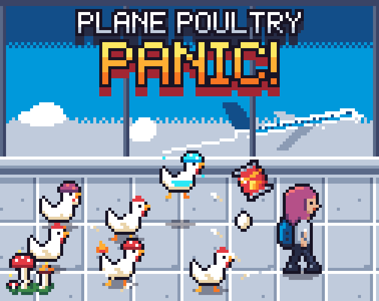
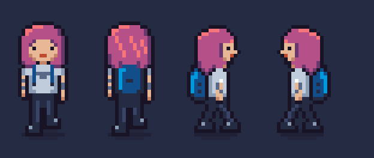

# Plane Poultry Panic



A 16-bit top-down action game: get through a chicken-overrun airport and catch the last flight out. Built with Godot 4.



## Play the prototype

1. Install Godot 4 (on macOS: `brew install --cask godot`).
2. Run the game from the repo root:

```bash
/Applications/Godot.app/Contents/MacOS/Godot --path game
```

Or open `game/project.godot` in the Godot editor and press F5.

| Action | Keyboard | Gamepad |
|---|---|---|
| Move | WASD or arrow keys | Left stick or D-pad |
| Run (uses stamina) | Shift | Right shoulder |
| Use the selected item (throw a snack, spray the extinguisher) | Space | A |
| Switch inventory slot | Q / R, or mouse wheel | LB / Y |
| Drop the selected slot | G | Back |
| Eat a snack (heal) | E | X |
| Push a cart, take an extinguisher | F | B |
| Restart (after winning or losing) | R | Start |

Reach the green **GATE** without losing all three suitcases. Chickens chase you when they see you; throw a snack and they'll go eat it instead.

## Run the smoke test

```bash
/Applications/Godot.app/Contents/MacOS/Godot --headless --path game res://tests/prototype_smoke.tscn
```

It drives the player with simulated input and exits non-zero on failure.

## Rebuild the sprites

Sprites are generated from Python sources in `tools/sprites/` (needs Pillow):

```bash
python3 tools/sprites/build.py --preview /tmp/sprite-previews
```

The walk GIF above is `player_walk.gif` from that preview folder, copied to `docs/images/`.

## Docs

- [Game design document](docs/game-design-document.md): how the game works
- [Roadmap](docs/roadmap.md): milestones from prototype to Steam
- [Art style guide](docs/art-style-guide.md): palette, sprite rules, sheet layouts
- [Storyline](docs/storyline.md): world and tone
